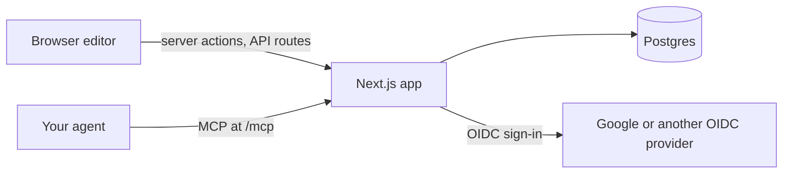

<div align="center">

<h1>slide</h1>

<p><strong>Slide decks in the browser: draw, point at a shape, and let your agent edit it.</strong></p>

[](https://github.com/zyx1121/slide/actions)
[](https://github.com/zyx1121/slide/pkgs/container/slide)
[](https://slide.zyx.tw)
[](LICENSE)

**English** | [繁體中文](README.zh-TW.md) | [简体中文](README.zh-CN.md)

</div>

```
> "Make the hi on slide 1 say Results, 24 pt bold"
  ⚡ get_deck { deck_id: "dk_a9q86y45ax" }
  ⚡ update_shapes { deck_id: "dk_a9q86y45ax", slide: 1, updates: [{ id: "sh_hdq4vujt", set: { text: { paragraphs: [{ runs: [{ text: "Results", size: 48, bold: true }], align: "center" }] } } }] }
✓ { status: "applied", entry: "42", changed: ["sh_hdq4vujt"] }
```

Many people draw slides by hand: rounded rectangles, connectors glued to them, text boxes placed where they fit. To ask an AI to change one box, you first have to describe where it is. slide keeps those drawing tools in the browser. You select a shape and tell your agent what to change, and you can still export a normal `.pptx`.

## Features

- **Draws like PowerPoint**: rectangles, rounded rectangles, ellipses, text boxes, pictures and connectors that stay glued when shapes move, with undo, copy and paste.
- **Types in place**: Chinese input methods work, and lines wrap where PowerPoint wraps them.
- **Gives your agent your selection**: over MCP, the agent gets the selected shapes as JSON, the marked words and a picture of that area.
- **Applies agent edits at once**: the history records every edit, yours and your agent's, and you can revert any one of them.
- **Imports and exports `.pptx`**: shapes stay native, connectors stay glued and text stays editable.
- **Presents on two screens**: the projector shows the slides, and your screen shows the next slide, your notes and a timer.
- **Publishes a deck**: a read-only link that anyone can open and download.

## Quick start

```sh
curl -fsSLO https://raw.githubusercontent.com/zyx1121/slide/main/compose.yaml
curl -fsSL -o .env https://raw.githubusercontent.com/zyx1121/slide/main/.env.example
# set POSTGRES_PASSWORD, APP_URL, OIDC_*, ALLOWED_EMAILS and SESSION_SECRET in .env
docker compose up -d
```

This starts Postgres, a one-shot migration job and the web app from `ghcr.io/zyx1121/slide`. Open `127.0.0.1:3000` and sign in. Uploaded pictures live on the `assets` volume, so back it up with the database.

> [!IMPORTANT]
> The app listens on 127.0.0.1 and speaks plain HTTP. Put a reverse proxy with TLS in front that passes the original `Host`, and register `APP_URL/auth/callback` as a redirect URI of your sign-in client. Let the proxy accept request bodies up to about 101 MiB, the largest `.pptx` import. In Caddy, that is `request_body { max_size 101MiB }`.

## Usage

1. Sign in with an email in `ALLOWED_EMAILS`. **新增** starts a deck on a master that you pick, and **匯入** turns a `.pptx` into a deck on its own master.
2. Edit on the slide. Double-click a shape or the title to type. The dock inserts shapes, text boxes, pictures and connectors, and a menu next to the selection styles it.
3. Connect your agent: `claude mcp add --transport http slide https://slide.example.org/mcp`, then sign in from `/mcp` and allow the agent.
4. Select shapes or words and leave comments with **評論**, then ask your agent to answer them. Or select shapes and ask for a change directly. **紀錄** lists every change and reverts any one.
5. Download a `.pptx` from the dock, or publish the deck with the globe button and share its `/s/…` link.

Your agent can also run `check_deck`, which reports text sizes, overflow, overlaps, contrast and colors outside the master's palette.

## Configuration

Set these in `.env`. [.env.example](.env.example) documents each one.

| Key                                                         | Sets                                                               | Default             |
| ----------------------------------------------------------- | ------------------------------------------------------------------ | ------------------- |
| `POSTGRES_PASSWORD`                                         | the bundled Postgres password                                      | required            |
| `APP_URL`                                                   | the public URL. The sign-in provider sends members back there      | required            |
| `OIDC_ISSUER`                                               | the OpenID Connect provider, such as `https://accounts.google.com` | required            |
| `OIDC_CLIENT_ID`, `OIDC_CLIENT_SECRET`                      | a confidential web client with the code flow and PKCE S256         | required            |
| `ALLOWED_EMAILS`                                            | comma-separated verified emails that can sign in                   | required            |
| `SESSION_SECRET`                                            | the key for the session cookie, 32 characters or more              | required            |
| `OTEL_EXPORTER_OTLP_ENDPOINT`, `OTEL_EXPORTER_OTLP_HEADERS` | where traces and error logs go, over OTLP/HTTP JSON                | off                 |
| `OTEL_SERVICE_NAME`                                         | the service name on the traces                                     | `slide`             |
| `ASSETS_DIR`                                                | where a run from source keeps pictures                             | `./data/assets`     |
| `MIGRATIONS_DIR`                                            | where the migrate role reads SQL files                             | `./migrations`      |
| `SLIDE_VERSION`                                             | the image tag that compose runs                                    | `latest`            |
| `SLIDE_BIND`, `SLIDE_PORT`                                  | where compose publishes the web port                               | `127.0.0.1`, `3000` |

## How it works



- One Next.js app and one Postgres database. Only verified emails in `ALLOWED_EMAILS` get in, and each member sees only their own decks.
- An agent signs in through the app's own OAuth server. The member allows it on a consent page, and the agent gets a one-hour access token and a rotating refresh token. The app stores only their hashes.
- Every edit, from the editor or an agent, goes through the same path, with the same rules, and becomes a revision.
- One renderer draws slides in the browser and, through resvg, on the server, with bundled fonts. Lines wrap the same everywhere.

## Limits

- A deck keeps the master that it starts on: plain, WinLab, or the master of an imported file.
- Import turns a table into one rectangle per cell, and leaves out charts, SmartArt, some freeforms and EMF, SVG or TIFF pictures. It reports what it left out.
- Pictures are PNG, JPEG or GIF, up to 10 MB and 50 million pixels.
- Text stops at 5,000 characters per shape and 20,000 per slide.
- Decks are private to their owner. Sharing with other members is not available yet.
- In Safari and Firefox, drag the projection window to the projector, then double-click it for full screen.

## For AI agents

Facts for coding agents and LLM tools. The rules for changing the code are in [AGENTS.md](AGENTS.md).

- **Summary**: Next.js and Postgres slide editor with a browser canvas, `.pptx` import and export, and an MCP server that edits decks for the signed-in member.
- **Type**: service
- **Interfaces**: HTTP web app. MCP at `/mcp` (streamable HTTP, OAuth). Public read-only decks at `/s/…`.
- **Install**: `docker compose up -d` with `compose.yaml` and `.env` from this repo
- **Run**: `docker compose up -d`, or `bun dev` from source
- **Verify**: `bun run typecheck && bun run lint && bun run format:check && bun run test`
- **Config**: `POSTGRES_PASSWORD`, `APP_URL`, `OIDC_ISSUER`, `OIDC_CLIENT_ID`, `OIDC_CLIENT_SECRET`, `ALLOWED_EMAILS`, `SESSION_SECRET`, `OTEL_*`, `ASSETS_DIR`, `MIGRATIONS_DIR`, `SLIDE_VERSION`, `SLIDE_BIND`, `SLIDE_PORT`
- **Secrets**: `.env` (the database password, the OIDC client secret, `SESSION_SECRET`). The app stores agent tokens as hashes only.
- **Limits**: decks are private to one member. Import drops charts, SmartArt and some picture formats.

## Development

```sh
bun install
sh scripts/fetch-fonts.sh
cp .env.example .env   # set DATABASE_URL to a Postgres that you can reach
bun run migrate
bun dev
```

CI runs the typecheck, the lint, the formatting test and the unit tests, then builds the image and smoke-tests the compose stack with [scripts/smoke.sh](scripts/smoke.sh).

## License

[MIT](LICENSE)
