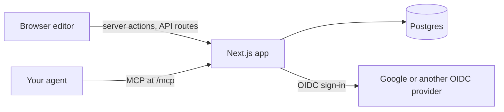

<!-- 翻译自 README.md @ docs/readme-template-v2。只翻译 "For AI agents" 之前的章节，英文版更新时一起改。 -->

<div align="center">

<h1>slide</h1>

<p><strong>在浏览器画幻灯片，指着图形，就让 agent 帮你改。</strong></p>

[](https://github.com/zyx1121/slide/actions)
[](https://github.com/zyx1121/slide/pkgs/container/slide)
[](https://slide.zyx.tw)
[](LICENSE)

[English](README.md) | [繁體中文](README.zh-TW.md) | **简体中文**

</div>

```
> "Make the hi on slide 1 say Results, 24 pt bold"
  ⚡ get_deck { deck_id: "dk_a9q86y45ax" }
  ⚡ update_shapes { deck_id: "dk_a9q86y45ax", slide: 1, updates: [{ id: "sh_hdq4vujt", set: { text: { paragraphs: [{ runs: [{ text: "Results", size: 48, bold: true }], align: "center" }] } } }] }
✓ { status: "applied", entry: "42", changed: ["sh_hdq4vujt"] }
```

很多人的幻灯片是手画的：圆角矩形、粘在上面的连接线、随手摆的文本框。想请 AI 改一个方框，得先描述它在哪里。slide 把这些绘图工具搬进浏览器，你选一个图形、告诉 agent 要改什么，最后一样能导出普通的 `.pptx`。

## 功能

- **像 PowerPoint 一样画**：矩形、圆角矩形、椭圆、文本框、图片，以及图形移动时仍然粘着的连接线，支持撤销、复制和粘贴。
- **直接在图形上打字**：中文输入法能用，换行位置和 PowerPoint 一样。
- **把选中内容交给 agent**：通过 MCP，agent 会拿到选中图形的 JSON、标记的文字和那一块的画面。
- **agent 的修改立即生效**：历史记录会留下每一次修改，不论是你还是 agent 改的，任何一条都能撤回。
- **导入导出 `.pptx`**：图形保持原生、连接线保持粘着、文字保持可编辑。
- **双屏演示**：投影仪只显示幻灯片，你的屏幕显示下一张、讲稿和计时器。
- **发布幻灯片**：生成一个任何人都能打开和下载的只读链接。

## 快速开始

```sh
curl -fsSLO https://raw.githubusercontent.com/zyx1121/slide/main/compose.yaml
curl -fsSL -o .env https://raw.githubusercontent.com/zyx1121/slide/main/.env.example
# 在 .env 设置 POSTGRES_PASSWORD、APP_URL、OIDC_*、ALLOWED_EMAILS 和 SESSION_SECRET
docker compose up -d
```

这会从 `ghcr.io/zyx1121/slide` 启动 Postgres、一次性的 migration 和网页应用。打开 `127.0.0.1:3000` 并登录。上传的图片存在 `assets` volume，请和数据库一起备份。

> [!IMPORTANT]
> 应用只监听 127.0.0.1，使用普通 HTTP。前面要放一个带 TLS 的反向代理，并保留原来的 `Host`；也要把 `APP_URL/auth/callback` 注册为登录客户端的 redirect URI。让代理接受约 101 MiB 以内的请求，这是 `.pptx` 导入的上限。Caddy 的写法是 `request_body { max_size 101MiB }`。

## 使用方法

1. 用 `ALLOWED_EMAILS` 里的邮箱登录。**新增** 用你选的母版新建一份幻灯片，**匯入** 把 `.pptx` 转成使用它自己母版的幻灯片。
2. 在幻灯片上编辑。双击图形或标题就能打字。下方的 dock 可以插入图形、文本框、图片和连接线，选中内容旁的菜单可以调整样式。
3. 连接 agent：`claude mcp add --transport http slide https://slide.example.org/mcp`，然后从 `/mcp` 登录并允许 agent。
4. 选中图形或文字，用 **評論** 留言，再请 agent 回复这些留言。或直接选中图形请它修改。**紀錄** 会列出每一次修改，并能撤回任何一条。
5. 从 dock 下载 `.pptx`，或用地球按钮发布幻灯片，分享它的 `/s/…` 链接。

agent 也可以运行 `check_deck`，报告字号、文字溢出、重叠、对比度，以及超出母版色板的颜色。

## 配置

在 `.env` 设置这些值，[.env.example](.env.example) 有每一项的说明。

| 参数                                                        | 作用                                                    | 默认值              |
| ----------------------------------------------------------- | ------------------------------------------------------- | ------------------- |
| `POSTGRES_PASSWORD`                                         | 内置 Postgres 的密码                                    | 必填                |
| `APP_URL`                                                   | 对外地址，登录服务会把成员带回这里                      | 必填                |
| `OIDC_ISSUER`                                               | OpenID Connect 服务，例如 `https://accounts.google.com` | 必填                |
| `OIDC_CLIENT_ID`、`OIDC_CLIENT_SECRET`                      | 使用 code flow 和 PKCE S256 的机密网页客户端            | 必填                |
| `ALLOWED_EMAILS`                                            | 可以登录的已验证邮箱，用逗号分隔                        | 必填                |
| `SESSION_SECRET`                                            | session cookie 的密钥，至少 32 个字符                   | 必填                |
| `OTEL_EXPORTER_OTLP_ENDPOINT`、`OTEL_EXPORTER_OTLP_HEADERS` | 追踪和错误日志的去向，用 OTLP/HTTP JSON                 | 关                  |
| `OTEL_SERVICE_NAME`                                         | 追踪数据上的服务名称                                    | `slide`             |
| `ASSETS_DIR`                                                | 从源码运行时存图片的位置                                | `./data/assets`     |
| `MIGRATIONS_DIR`                                            | migrate 读取 SQL 文件的位置                             | `./migrations`      |
| `SLIDE_VERSION`                                             | compose 运行的镜像 tag                                  | `latest`            |
| `SLIDE_BIND`、`SLIDE_PORT`                                  | compose 对外开放网页端口的位置                          | `127.0.0.1`、`3000` |

## 工作原理



- 一个 Next.js 应用加一个 Postgres。只有 `ALLOWED_EMAILS` 里的已验证邮箱能进来，每位成员只看得到自己的幻灯片。
- agent 通过应用自己的 OAuth 服务器登录。成员在同意页允许后，agent 拿到一小时的访问令牌和会轮换的刷新令牌，应用只存它们的哈希。
- 不论来自编辑器还是 agent，每一次修改都走同一条路径、同一套规则，并存成一个版本。
- 同一个渲染器在浏览器画幻灯片，在服务器通过 resvg 画，字体都内置，所以每个地方换行都一样。

## 限制

- 幻灯片会一直使用创建时的母版：plain、WinLab，或导入文件自己的母版。
- 导入时，表格会变成每格一个矩形；图表、SmartArt、部分自由图形，以及 EMF、SVG、TIFF 图片会被略过，并会告诉你略过了什么。
- 图片限 PNG、JPEG 或 GIF，最大 10 MB、5,000 万像素。
- 文字上限是每个图形 5,000 字符、每张幻灯片 20,000 字符。
- 幻灯片只属于所有者，目前还不能分享给其他成员。
- 在 Safari 和 Firefox，要自己把投影窗口拖到投影仪，再双击进入全屏。

## 其他

给 AI agent 的结构化信息与开发说明见[英文版](README.md#for-ai-agents)。

## 许可证

[MIT](LICENSE)
