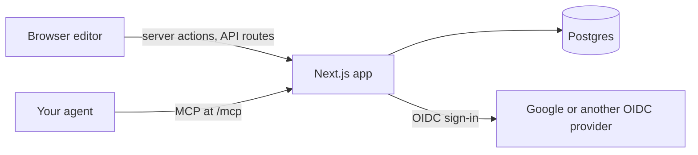

<!-- 翻譯自 README.md @ docs/readme-template-v2。只翻 "For AI agents" 以上的章節，英文版更新時一起改。 -->

<div align="center">

<h1>slide</h1>

<p><strong>在瀏覽器畫投影片，指著圖形，就讓 agent 幫你改。</strong></p>

[](https://github.com/zyx1121/slide/actions)
[](https://github.com/zyx1121/slide/pkgs/container/slide)
[](https://slide.zyx.tw)
[](LICENSE)

[English](README.md) | **繁體中文** | [简体中文](README.zh-CN.md)

</div>

```
> "Make the hi on slide 1 say Results, 24 pt bold"
  ⚡ get_deck { deck_id: "dk_a9q86y45ax" }
  ⚡ update_shapes { deck_id: "dk_a9q86y45ax", slide: 1, updates: [{ id: "sh_hdq4vujt", set: { text: { paragraphs: [{ runs: [{ text: "Results", size: 48, bold: true }], align: "center" }] } } }] }
✓ { status: "applied", entry: "42", changed: ["sh_hdq4vujt"] }
```

很多人的投影片是手畫的：圓角矩形、黏在上面的連接線、隨手擺的文字方塊。想請 AI 改一個方塊，得先描述它在哪裡。slide 把這些繪圖工具搬進瀏覽器，你選一個圖形、告訴 agent 要改什麼，最後一樣能匯出一般的 `.pptx`。

## 功能

- **像 PowerPoint 一樣畫**：矩形、圓角矩形、橢圓、文字方塊、圖片，以及圖形移動時仍然黏著的連接線，支援復原、複製和貼上。
- **直接在圖形上打字**：中文輸入法能用，換行位置跟 PowerPoint 一樣。
- **把選取內容交給 agent**：透過 MCP，agent 會拿到選取圖形的 JSON、標記的文字和那一塊的畫面。
- **agent 的修改立即生效**：紀錄會留下每一次修改，不論是你或 agent 改的，任何一筆都能還原。
- **匯入匯出 `.pptx`**：圖形維持原生、連接線維持黏著、文字維持可編輯。
- **雙螢幕簡報**：投影機只顯示投影片，你的螢幕顯示下一張、講稿和計時器。
- **發布投影片**：產生一個任何人都能開啟和下載的唯讀連結。

## 快速開始

```sh
curl -fsSLO https://raw.githubusercontent.com/zyx1121/slide/main/compose.yaml
curl -fsSL -o .env https://raw.githubusercontent.com/zyx1121/slide/main/.env.example
# 在 .env 設定 POSTGRES_PASSWORD、APP_URL、OIDC_*、ALLOWED_EMAILS 和 SESSION_SECRET
docker compose up -d
```

這會從 `ghcr.io/zyx1121/slide` 啟動 Postgres、一次性的 migration 和網頁 app。打開 `127.0.0.1:3000` 並登入。上傳的圖片存在 `assets` volume，請和資料庫一起備份。

> [!IMPORTANT]
> app 只聽 127.0.0.1，用的是一般 HTTP。前面要放一個有 TLS 的反向代理，並保留原本的 `Host`；也要把 `APP_URL/auth/callback` 註冊成登入用戶端的 redirect URI。讓代理接受約 101 MiB 以內的請求，這是 `.pptx` 匯入的上限。Caddy 的寫法是 `request_body { max_size 101MiB }`。

## 使用方式

1. 用 `ALLOWED_EMAILS` 裡的 email 登入。**新增** 用你選的母片開一份投影片，**匯入** 把 `.pptx` 轉成用它自己母片的投影片。
2. 在投影片上編輯。雙擊圖形或標題就能打字。下方的 dock 可以插入圖形、文字方塊、圖片和連接線，選取內容旁的選單可以調整樣式。
3. 連接 agent：`claude mcp add --transport http slide https://slide.example.org/mcp`，然後從 `/mcp` 登入並允許 agent。
4. 選取圖形或文字，用 **評論** 留言，再請 agent 回覆這些留言。或直接選取圖形請它修改。**紀錄** 會列出每一次修改，並能還原任何一筆。
5. 從 dock 下載 `.pptx`，或用地球按鈕發布投影片，分享它的 `/s/…` 連結。

agent 也可以執行 `check_deck`，回報字級、文字溢出、重疊、對比，以及超出母片色票的顏色。

## 設定

在 `.env` 設定這些值，[.env.example](.env.example) 有每一項的說明。

| 參數                                                        | 作用                                                    | 預設                |
| ----------------------------------------------------------- | ------------------------------------------------------- | ------------------- |
| `POSTGRES_PASSWORD`                                         | 內建 Postgres 的密碼                                    | 必填                |
| `APP_URL`                                                   | 對外網址，登入服務會把成員導回這裡                      | 必填                |
| `OIDC_ISSUER`                                               | OpenID Connect 服務，例如 `https://accounts.google.com` | 必填                |
| `OIDC_CLIENT_ID`、`OIDC_CLIENT_SECRET`                      | 使用 code flow 和 PKCE S256 的機密網頁用戶端            | 必填                |
| `ALLOWED_EMAILS`                                            | 可以登入的已驗證 email，用逗號分隔                      | 必填                |
| `SESSION_SECRET`                                            | session cookie 的金鑰，至少 32 個字元                   | 必填                |
| `OTEL_EXPORTER_OTLP_ENDPOINT`、`OTEL_EXPORTER_OTLP_HEADERS` | 追蹤和錯誤 log 的去處，用 OTLP/HTTP JSON                | 關                  |
| `OTEL_SERVICE_NAME`                                         | 追蹤資料上的服務名稱                                    | `slide`             |
| `ASSETS_DIR`                                                | 從原始碼執行時存圖片的位置                              | `./data/assets`     |
| `MIGRATIONS_DIR`                                            | migrate 讀取 SQL 檔的位置                               | `./migrations`      |
| `SLIDE_VERSION`                                             | compose 執行的映像檔 tag                                | `latest`            |
| `SLIDE_BIND`、`SLIDE_PORT`                                  | compose 對外開放網頁 port 的位置                        | `127.0.0.1`、`3000` |

## 運作方式



- 一個 Next.js app 加一個 Postgres。只有 `ALLOWED_EMAILS` 裡的已驗證 email 能進來，每位成員只看得到自己的投影片。
- agent 透過 app 自己的 OAuth 伺服器登入。成員在同意頁允許後，agent 拿到一小時的存取權杖和會輪替的更新權杖，app 只存它們的雜湊。
- 不論來自編輯器還是 agent，每一次修改都走同一條路徑、同一套規則，並存成一個版本。
- 同一個渲染器在瀏覽器畫投影片，在伺服器透過 resvg 畫，字型都內建，所以每個地方換行都一樣。

## 限制

- 投影片會一直用建立時的母片：plain、WinLab，或匯入檔案自己的母片。
- 匯入時，表格會變成每格一個矩形；圖表、SmartArt、部分自由圖形，以及 EMF、SVG、TIFF 圖片會被略過，並會告訴你略過了什麼。
- 圖片限 PNG、JPEG 或 GIF，最大 10 MB、5,000 萬像素。
- 文字上限是每個圖形 5,000 字元、每張投影片 20,000 字元。
- 投影片只屬於擁有者，目前還不能分享給其他成員。
- 在 Safari 和 Firefox，要自己把投影視窗拖到投影機，再雙擊進入全螢幕。

## 其他

給 AI agent 的結構化資訊與開發說明在[英文版](README.md#for-ai-agents)。

## 授權

[MIT](LICENSE)
